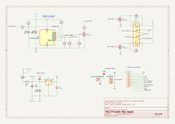

// SPDX-License-Identifier: CERN-OHL-P-2.0

= ATtiny13A Relay Bypass Module and Quasi-IC

== Overview

The design and intent of this module is broadly similar to that of
its sister projects,
link:../attiny13a-buffered-electrical-bypass-quasi-ic/[attiny13a-buffered-electrical-bypass-quasi-ic]
and
link:../attiny202-buffered-electrical-bypass-quasi-ic/[attiny202-buffered-electrical-bypass-quasi-ic].
Briefly, this
module is intended to offer the same "plug and play" convenience of
an integrated circuit, one that offers analog signal
switching, as well as engage/bypass state management
and status LED lighting/darking.

This module's key differences are:

  * This project uses through-hole components, and is therefore
    physically larger
  * While the project has "ATtiny13A" in the name, it actually uses
    any of three microcontrollers from the the "AVR Classic" family;
    specifically, firmware exists for ATtiny13A, ATtiny45, and
    ATtiny85 (the firmware is identical for all MCUs, except in
    necessary hardware-specific details)
  * Like the ATtiny13A-based Quasi-IC, this PCB uses a single row of
    pin headers; in fact the two modules are designed to be
    interchangeable
  * This module contains no buffers
  * This module uses a mechanical relay (Panasonic TQ-L2-5V) for
    true bypass switching
  * This module has additional I/O for use as a standalone module
    with commercial/off-the-shelf (COTS) PCBs (e.g. link:https://www.pedalpcb.com/[PedalPCB] 
    or link:https://www.aionfx.com/[AionFX] 
  * This is a "belt-and-suspenders" design (see below) that
    decouples the MCU from the relay coil via MOSFETs and protection
    diodes; thus, it can be easily adapted for use with other MCUs

== Design Notes

This is deliberately a "belt-and-suspenders" design.  That is, some
may argue that the design is over-engineered with some extraneous
parts.  Specifically: the use of the relay coil flyback protection
diodes (D1, D3), and the coil-current-sinking MOSFETs (Q1, Q3).  In
similar designs, the AVR MCU directly drives the relay coil,
removing the need for the protection diodes and current-sinking
transistors.  The AVR Classic MCU GPIO pins have built-in protection
diodes _and_ are rated to source/sink the relay coil current.
Similarly, it is also possible for the MCU to directly drive the
status LED.

Using the MOSFETs and protection diodes to isolate the relay coil
from the MCU provides additional safety for the MCU, though at the
expense of added PCB footpring and BOM cost.  Additionally, it makes
the design trivially adaptable to other microcontrollers which may
not have GPIO pins that are as rugged as the AVR Classic.  (MOSFET
gates present virtually zero load, so can be trivially activated by
practically any logic chip.)

While generally we refer to the TQ-L2-5V part for the relay, the
*TQ-L2-4.5V* is arguably the ideal part.  There is a voltage drop of
approximately 0.7V across the MOSFETs when they are switched on.
Therefore, the actual voltage presented to the relay coils is
approximately 4.3V, rather than 5V.  Thus, the "4.5V" part is a
better fit.  However, in practice, the 4.5V part is less common and
generally more expensive.  Given that the operating margins of the
TQ2 parts are fairly generous, the 5V part still has sufficient
margin in this design and works reliably.  Choose the 4.5V part only
if it's available and the cost is the same as the 5V part.

== Schematic

link:attiny-tq2-l2-5v.pdf[Downloadable PDF]

== Module Pinout

This module has a total of 15 pins with 2.54mm pitch.  There is
essentially three groups of pin headers.  The overall numbering, as
viewed from the component side, is somewhat awkward: 10, 11, 1, 2,
3, 4, 5, 6, 7, 8, 9, 12, 13, 14, 15.

The awkward numbering is so that the middle group of pins, i.e. 1
through 9, are compatible with the other quasi-IC modules that only
have these pins.

The other two groups of pins (10,11) and (12,13,14,15) allow the
module to be used generically with COTS PCBs.

....
 10| 11     1 | 2 | 3 | 4 | 5 | 6 | 7 | 8 | 9      12| 13| 14| 15
GND|VDC    +9V|GND|JIN|SND|LSW|RET|JOU|GND|FSW    GND|GND|LSW|+5V
....

[cols="1,2,6",options="header"]
|===
| Pin | Signal | Description

| 10, 2, 8, 12, 13
| GND
| Ground (0-volt)

| 11
| VDC
| Post-reverse polarity projection supply voltage; this is the
voltage that is created from the +9V pin, _after_ D2 and R13; this
can be used to power an effect PCB, particularly for many from AionFX 

| 1
| +9V
| Supply input; the module has a reverse-polarity shunt diode (D2)
and a 100-ohm series resistor (R13) on this pin

| 3
| JIN
| Signal input, from the input jack; goes to the input buffer

| 4
| SND
| Buffered signal to the effect circuit's input, switched by the
TMUX4053 and AC-coupled (C10)

| 5, 14
| LSW
| Status LED cathode, switched to ground by Q3 through a 4.7k-ohm
resistor (R26) on the module.  Connect the LED's anode to the supply;
the parent PCB _may_ need additional current-limiting resistance,
depending on desired LED brightness and/or LED type (I typically add
an additional 3.3k-ohm for ultrabright/high-efficiency LEDs)

| 6
| RET
| The effect circuit's output, returning to the module; AC-coupled
(C9)

| 7
| JACK_OUT
| Buffered signal output, to the output jack

| 9
| FSW
| Momentary, normally-open footswitch to ground; the pull-up, ferrite
bead, RC filter and ESD protection are on the module

| 15
| +5V
| The +5V supply used by the AVR MCU and the relay itself; this pin,
along with the LSW pin, can be used for the status LED (note that
generally a smaller current-limiting resistor can be used with 5V
versus 9V)
|===

// TODO: supply voltage range and typical current draw.

== Modifying

The KiCad project is
link:attiny-tq2-l2-5v.kicad_pro[attiny-tq2-l2-5v.kicad_pro],
in this directory.  KiCad version 10.0.5 was used.

== Fabrication and Assembly

The following files are offered for fabrication.  Caveats,
disclaimers and warnings:

  * I used these with link:JLCPCB[https://www.jlcpcb.com]; their
    suitability for other fabricators is unknown
  * They were generated from the KiCad project via
    link:kicad-jlcpcb-tools[https://github.com/bouni/kicad-jlcpcb-tools]

The files:

  * link:GERBER-attiny-tq2-l2-5v.zip[GERBER-attiny-tq2-l2-5v.zip]:
    Gerber files
  * BOM coming soon

== Build Reports

  * link:https://forum.pedalpcb.com/threads/pez-rojo-custom-menatone-red-snapper.30439/[Pez Rojo]
    (originally used the ATtiny202 quasi-IC, but later changed to this module)

